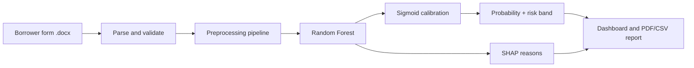

# Credit Risk Dashboard

Upload a filled borrower form (Word, `.docx`) and get a **calibrated estimate of default risk**, a risk band, a review flag, and the top reasons behind the estimate, all in one Streamlit dashboard.

**Live demo:** https://borrower-risk-estimator.streamlit.app
*(Use made-up data only. Please do not upload real personal or financial information.)*

<!-- Add 2-3 screenshots here, for example:


-->

---

## Overview

Most credit-risk demos stop at a notebook. This project goes end to end:

1. A borrower's credit history arrives as a **Word form** (fixed template).
2. The app **parses and validates** it, and shows clear errors for bad input.
3. A **Random Forest** estimates the chance of serious delinquency (90+ days past due within two years).
4. The raw score is **calibrated**, so the number shown is a realistic probability and not just a ranking score.
5. The dashboard shows the **risk band**, a **review flag**, the **top reasons** (SHAP), and exports **PDF / CSV reports**.



## Features

- **DOCX intake** with field-level validation and readable error messages
- **Calibrated default probability** (not an inflated class-weighted score)
- **Risk bands:** Low (under 5%), Medium (5-15%), High (15-30%), Very high (30%+), with a review flag at 15%
- **Top-5 reasons** per borrower using SHAP (a ranking of influences, not percentages)
- **PDF and CSV reports** per assessment
- **Per-session history:** reports are kept only in the user's own browser session and are lost on refresh, so one visitor can never see another visitor's data

## The form

| Used by the model | Display only (does not affect the estimate) |
|---|---|
| Age | Yearly revenue |
| Monthly income | Tax paid |
| Credit usage (share of limit used) | Repayment record |
| Debt ratio | |
| Times 30-59, 60-89 and 90+ days late | |
| Open credit lines and loans | |
| Real estate loans | |
| Number of dependents | |

Monthly income is converted from PKR to USD at a fixed approximate rate before scoring, because the training data is in a different currency context.

## Data

- **Dataset:** [Give Me Some Credit](https://www.kaggle.com/competitions/GiveMeSomeCredit) (Kaggle, 2011): 150,000 borrowers, 10 features, target `SeriousDlqin2yrs` (90+ days past due within 2 years).
- **Class imbalance:** only 6.6% of borrowers are in the positive class, so accuracy is not a useful metric. Models are judged by PR-AUC, with recall and precision reported at a chosen cut-off.
- **Cleaning** (149,165 rows kept):
  - 609 duplicate rows removed
  - 1 row with an impossible age removed
  - 225 rows with the placeholder codes 96/98 in the late-payment columns removed (these rows had a 60% serious-trouble rate, so this is a documented choice, not a sign they were unimportant)
- **Split:** stratified 80/20 train/test (119,332 / 29,833), done before any preprocessing. The test set was used once, at the end.

## Method

| Step | Choice |
|---|---|
| Preprocessing | Median imputation, an "income not reported" flag (missing income carried its own signal), log transform and scaling for income, debt ratio and credit usage; fitted on train only inside a pipeline |
| Models compared | Logistic Regression, Decision Tree, Random Forest (5-fold cross-validation, balanced class weights) |
| Tuning | Randomized search (10 combinations, 3-fold) on the Random Forest |
| Calibration | Sigmoid (Platt) calibration fitted on out-of-fold scores, chosen over isotonic for being equally accurate and smoother |
| Explainability | SHAP (TreeExplainer) |

## Notebook
The full training workflow (cleaning, EDA, model comparison, tuning, calibration and final evaluation) is in [`notebooks/Fintech_Loan.ipynb`](notebooks/Fintech_Loan.ipynb).
It was written in Google Colab and reads the Kaggle file `cs-training.csv.zip` from Google Drive, so download the dataset from Kaggle first if you want to re-run it.

[Open in Colab](https://colab.research.google.com/github/ghuzi/credit-risk-dashboard/blob/main/notebooks/Fintech_Loan.ipynb)


**Model comparison (5-fold cross-validation on the training set):**

| Model | PR-AUC | ROC-AUC |
|---|---|---|
| Random Forest | 0.388 | 0.864 |
| Decision Tree | 0.352 | 0.849 |
| Logistic Regression | 0.350 | 0.856 |

A model guessing at random would score a PR-AUC of about 0.066 (the share of risky borrowers).

**Calibration:** before calibration the model predicted 30.6% risk on average while the real rate was 6.6%. After calibration the average matches, and the Brier score fell from 0.132 to 0.049 (a lazy "always say the average" model scores 0.062).

## Results (held-out test set)

| Metric | Value |
|---|---|
| PR-AUC | 0.386 |
| ROC-AUC | 0.855 |
| Brier score | 0.0495 (baseline 0.0618) |
| Recall at the 15% review cut-off | 0.561 |
| Precision at the 15% review cut-off | 0.329 |
| Borrowers flagged | 11.3% |

In plain words: the model ranks borrowers well and its probabilities are realistic, but it is not a crystal ball. At the review cut-off it catches a little over half of the borrowers who later got into serious trouble, and about one in three flagged borrowers really did.

## Limitations (please read)

- **Not a lending tool.** The model is trained on a 2011 public consumer-credit dataset, not on Pakistani borrowers, and it has not been validated for real lending decisions.
- **No tax or revenue in the training data.** Yearly revenue, tax paid and repayment record are shown on the dashboard but do not change the probability.
- **Currency and market mismatch.** Income is converted at a fixed approximate PKR-to-USD rate, which is a rough bridge, not a proper localization.
- **Hyperparameter tuning did not meaningfully improve the model** over the default-style settings; the limit comes from the information in the ten features. Logistic Regression and Decision Tree were not tuned.
- **Age is a model input.** In real lending, age is often restricted as a decision factor.
- **Correlation, not causation.** SHAP reasons describe what the model relies on, not what causes default.
- **Low precision.** Many flagged borrowers are false alarms, which is why the app reports a probability and a review flag instead of a hard "approve/reject".

## Project structure

```
credit_risk_dashboard/
├── app.py                 # Streamlit app (pages, charts, upload flow)
├── form_parser.py         # DOCX parsing and validation
├── scoring.py             # Loads the model bundle, returns probability, band, reasons
├── reports.py             # PDF and CSV report generation
├── history.py             # Per-session report history
├── model/
│   ├── credit_risk_bundle.joblib   # Preprocessing + Random Forest + calibrator + band thresholds
│   └── shap_importance.png
├── templates/             # Blank borrower form (.docx)
├── test_forms/            # Made-up sample forms for testing
└── requirements.txt
```

## Run locally

Python 3.11 is recommended.

```bash
git clone https://github.com/ghuzi/credit-risk-dashboard.git
cd credit-risk-dashboard
python -m venv venv
venv\Scripts\activate          # Windows (on macOS/Linux: source venv/bin/activate)
pip install -r requirements.txt
streamlit run app.py
```

`scikit-learn` is pinned to `1.6.1` because the model bundle was saved with that version; loading it with a different version may raise warnings or errors.

To try the app, upload a form from `test_forms/` (all sample data is made up).

## Tech stack

Python, Streamlit, scikit-learn, SHAP, pandas, NumPy, Plotly, python-docx, ReportLab, joblib.

## Disclaimer

This project is for learning and portfolio purposes. It is not financial advice and must not be used to make real credit decisions.

## Author

**Muhammad Ghuzaif** · [GitHub](https://github.com/ghuzi)
